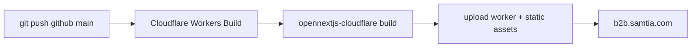

# 018 — Release and Build Process

**Purpose:** a step-by-step runbook for actually *executing* a release — commands, files to
edit, and the order to do it in. [014](014-Deployment-Architecture.md) documents the pipelines'
architecture (what deploys where, and why); [017](017-Odoo.sh-Environments-Guide.md) documents
the Odoo.sh branch-promotion policy. This document is the missing third piece: given a finished
change sitting in a feature branch, what does a developer actually type to ship it, in what
order, and what mistakes have already cost time.

**Audience:** any developer cutting a release — written so a new team member can do one without
asking a teammate to walk them through it. Driving this same process through the Claude Code
agent instead of typing each command is covered in
[018.1 — AI-Agent-Assisted Deployment](018.1-AI-Agent-Assisted-Deployment.md) — read that first if
the agent is available; come back here when a skill is missing or you need the exact command. For
a pure copy-paste command sequence with no explanation, see
[018.2 — Manual Deployment Runbook](018.2-Manual-Deployment-Runbook.md).

---

## Two Independent Release Tracks

The platform has two release tracks that version, build and deploy **independently**. They are
tied together only by cross-references inside the frontend's own release notes.

| | Frontend (`next_ecommerce`) | Backend (`addons_lp_ecommerce`) |
| --- | --- | --- |
| Version scheme | `NEXT_PUBLIC_APP_VERSION`, semver (patch/minor only) | Odoo manifest `version` **and** a separate `BUILD_NUMBER` |
| Release notes | `_docs/releases/<version>.json` (one file per app version) | `_docs/releases/<module_version>_build<N>.md` |
| Built by | `opennextjs-cloudflare build` (prod) or Docker (`docker/<env>/`) (non-prod) | Odoo.sh (ERP Team merges the submodule pointer) |
| Deployed via | Push to GitHub `main` (prod, automatic) or `build_upload_amd64.sh --deploy` (non-prod, manual) | Azure DevOps PR → GitHub sync → ERP Team submodule update |
| Verified via | `/release-notes` page in the portal | `GET /ecommerce/api/build-info` |

Because the two halves version independently, **the frontend's release-note file is the record
that ties a release together** — it carries a `headCommitBackend` field pointing at the backend
commit shipping alongside it. See [014 — Coordinating the Pipelines](014-Deployment-Architecture.md#coordinating-the-pipelines)
for the ordering rule this implies: when a change spans both halves, ship the **backend first**
— the frontend tolerates an unfamiliar backend field far better than the reverse, and Cloudflare
deploys in minutes while Odoo.sh production is the slowest hop in the platform.

---

## Frontend Release Process (`next_ecommerce`)

### Step 1 — Sync before starting

```bash
cd next_ecommerce
git fetch origin && git status -sb
git pull --ff-only origin main   # only if behind and the tree is clean
```

Local `main` can sit many commits behind `origin/main` between sessions. Branching for a
release off a stale `main` produces a diff that silently misses real commits — do this first,
every time.

Also check for a leftover unmerged release branch from a previous session:

```bash
git branch -a | grep -iE "bump|release/"
```

If one exists and `main` has since moved past it, treat it as superseded — branch fresh with a
different name and mention the stale branch rather than silently reusing or force-deleting it.

### Step 2 — Decide the version bump

Semver decided from what's actually in the diff, not by habit:

| Bump | When |
| --- | --- |
| **Patch** (`1.2.0` → `1.2.1`) | Bug-fix-only release, nothing new to use |
| **Minor** (`1.2.1` → `1.3.0`) | Adds something a user can see — a new page/route, a new button or action, a new column/report, new behaviour on an existing screen. If a `highlights` entry reads "You can now …", it's a minor bump |
| Major | Not used on this project — don't bump it without asking |

State the reasoning in the release file's `note` field so the choice is auditable later.

### Step 3 — Write the release-note file

Location: `_docs/releases/<version>.json` (template: `_docs/releases/_TEMPLATE.json`).

Schema: `{ version, date, headCommit, headCommitBackend, environments, pr, changes, highlights,
verify, note }`. Two fields serve different audiences — don't conflate them:

| Field | Audience | Rules |
| --- | --- | --- |
| `changes` | Internal, technical | `git log`-derived, one bullet per commit/PR, commit-message style. Never shown publicly. |
| `highlights` | Business / non-technical | The **only** field the public `/release-notes` page reads. Describe *what changed for the user*, not *how* — no `fix(scope): …` prefixes, no file/function names. Mandatory for anything user-facing; purely internal changes (refactors, tooling, deploy scripts) can omit `highlights` entirely. |

Each `highlights` entry is `{ "portal": "general" | "client" | "amp" | "backoffice", "text": "…" }`
— not a plain string. Pick `portal` by checking which route/component the change actually lives
in (`git diff-tree --no-commit-id --name-only -r <sha>`), not by guessing from the commit
message:

- `client` — touches Customer Portal routes/components (served from `/`).
- `amp` — touches Account Management Portal routes/components (served from `/admin/*`).
- `general` — the diff genuinely spans **both** portals, or is portal-agnostic infra. A shared
  low-level component (e.g. `common/ui/**`) being *capable* of use in both portals does not by
  itself make a fix `general` if every other touched file sits under one portal's tree.
- `backoffice` — the change actually lives in `addons_lp_ecommerce`, not in `next_ecommerce` at
  all (see Step 3b below).

A missing/invalid `portal` falls back to `general` rather than breaking the build — don't rely
on that, tag it correctly.

#### Step 3b — Fold in backend changes

`headCommitBackend` (sibling of `headCommit`) records the `addons_lp_ecommerce` commit as of
this release, so one file tells the full "what shipped" story:

1. Read the previous release file's `headCommitBackend` (`jq -r .headCommitBackend <file>.json`).
   If `null` (tracking not started yet), just record the current backend HEAD as the new
   baseline and skip step 2.
2. Otherwise, `cd addons_lp_ecommerce && git log --oneline <that-sha>..HEAD` to see what landed
   on the backend since the last release note. Summarize into `changes` (prefixed `[backend]`)
   and, for anything with real operational effect, add a `highlights` entry tagged
   `"portal": "backoffice"`.
3. Set `headCommitBackend` to the backend repo's current HEAD (`git rev-parse HEAD`).

This is informational tracking only — it does not imply the backend was deployed together with
this frontend release; the two deploy on independent schedules.

Populate `headCommit` itself the same way, but for the frontend repo:
`git log --oneline <previous release's headCommit>..HEAD`. **Caveat:** `headCommit` records the
*previous* release's branch-off point, not that release's own tip, so the diff range also
includes the previous release's own bump/release-note commit — cross-check against the previous
file's own `changes` array and exclude anything already documented there.

### Step 4 — Bump `NEXT_PUBLIC_APP_VERSION`

Each environment duplicates the same values in **two places** — both must be edited together or
the built image and the running compose file will disagree:

- Non-production: `docker/<env>/.env.<env>` **and** `docker/<env>/docker-compose.yml` (under
  `services.next-portal.environment`)
- Production: `.env.production` at the repo root

Edit only the environment(s) actually shipping this release.

### Step 5a — Build & deploy: non-production (Docker)

```bash
# Single environment
bash docker/<env>/build_upload_amd64.sh --deploy

# All three staging environments at once (pre-prod, staging-b2b, training-b2b)
bash docker/build_deploy_all_staging.sh
```

`<env>` is one of `training`, `pre-prod`, `staging-b2b`, `training-b2b` — `training` is not
included in the combined script and is deployed on its own. Under the hood, per environment,
this builds a `linux/amd64` image tagged both `<env>` and `<env>-<version>`, saves both tags to
one tar under `docker/build_releases/<env>/`, `scp`s it to the server, then (with `--deploy`)
loads, retags and pushes both tags to the server's local registry.

**The script never restarts the running container.** In Portainer: Stacks → the stack for that
environment → Editor → update the stack with **Re-pull image and redeploy** enabled. This step
cannot be done from the CLI — it requires the Portainer UI.

### Step 5b — Build & deploy: production (Cloudflare)

Production has no manual build step — pushing to the GitHub remote's `main` is the deploy
action, full stop, with no review gate:



Before pushing:
- The change has already been validated on `staging-b2b` and `pre-prod`.
- Any backend change it depends on has already reached Odoo.sh `production` — see the ordering
  risk in [014](014-Deployment-Architecture.md#the-ordering-risk-introduced-by-cicd).
- Rehearse locally first — the Worker build differs from the container build:
  `npm run preview:cloudflare`.

> **Gotcha — `public/release-history.json` generation must not depend on which command invoked
> the build.** This file is gitignored and normally regenerated by `scripts/generate-release-
> history.mjs` via npm's `predev`/`prebuild`/`prebuild:docker` hooks. Cloudflare Workers Builds
> runs `npx opennextjs-cloudflare build` directly rather than through `npm run build`, so those
> npm hooks never fire there — a build could succeed while `/release-notes` silently renders
> empty in production. The generator is invoked as an import side-effect of `next.config.ts`
> instead, so it runs on every path that loads Next's config regardless of which command or npm
> hook triggered the build. If `/release-notes` ever goes empty again after a build that
> otherwise succeeded, this is the first thing to check — verify with
> `curl https://b2b.samtia.com/release-history.json` (the raw static asset, served independently
> of the page) against what the page itself renders; if the asset has data but the page doesn't,
> suspect a server component reading the file via `node:fs` at render time — Cloudflare Workers
> has no real filesystem for that, even though the same file serves fine as a plain static asset.
> Fixed 2026-09-20 by switching the page to a build-time `import` of the JSON instead of a
> runtime `fs.readFileSync`.

### Step 6 — Sync the GitHub mirror

Azure DevOps (`origin`) is the source of truth; GitHub (`github`) is a fast-forward-only mirror
that Cloudflare actually watches. **Mandatory every time a frontend release lands on `main`:**

```bash
bash next_ecommerce/scripts/sync_github_from_azure.sh
```

This only fast-forwards the `main` ref on GitHub — it never touches the local working tree, so
it's safe to run with uncommitted local changes. It aborts (no force push) if `github/main` has
commits `origin/main` doesn't, which needs manual resolution first. Run this after merging to
`main`, not after every feature-branch push.

### Step 7 — Verify

- `/release-notes` on the deployed environment shows the new entry.
- Non-production: confirm the running container actually picked up the new image (Portainer
  shows the new tag; the page footer/version indicator matches).
- Production: `b2b.samtia.com` serves the new version once the Cloudflare build completes.

---

## Backend Release Process (`addons_lp_ecommerce`)

### Step 1 — Sync before starting

Same pattern as the frontend — stale local `main` produces a release note whose diff misses
real commits:

```bash
cd addons_lp_ecommerce
git fetch origin && git status -sb
git pull --ff-only origin main   # only if behind and the tree is clean
git branch -a | grep -i bump     # check for a leftover unmerged bump branch first
```

If a stale bump branch exists and `main` has moved past it, don't build on top of it or reuse
its name — branch fresh (e.g. `release/<version>-build<N>`) and flag the stale one.

### Step 2 — Bump `BUILD_NUMBER` (mandatory, every deployable change)

`ecommerce/controllers/build_info_api.py` holds a `BUILD_NUMBER` constant exposed at the public
endpoint `GET /ecommerce/api/build-info` (returns `build_number` + `module_version` read live
from disk — no module upgrade needed to check it). This is the **only** way to verify from
outside whether the ERP Team's submodule update actually picked up the latest code, so every
commit that must be verifiable on a server increments it.

### Step 3 — Check before bumping the module version

Compare `grep version ecommerce/__manifest__.py` against the latest release file's `Module
version`. A feature/migration PR may have already raised the manifest version since the last
release file — if the manifest is already ahead, **keep it as-is** and only move `BUILD_NUMBER`;
bumping the manifest version again would skip a version for no reason.

### Step 4 — Write the release-note file

Location: `_docs/releases/<module_version>_build<BUILD_NUMBER>.md` (e.g.
`19.0.1.0.2_build5.md`, template: `_docs/releases/_TEMPLATE.md`).

1. Find the latest existing release file and read its `Head commit`.
2. `git log --oneline <that-sha>..HEAD` to see what's shipping. **Same caveat as the frontend:**
   `Head commit` is the previous release's branch-off point, not its tip, so this range also
   includes the previous release's own bump commit — cross-check and exclude anything already
   documented there.
3. Write `## Changes` in plain business language (what changed for the user/operator, not
   commit-message jargon), with the PR number in parentheses for traceability — the same
   business-tone rule the frontend's `highlights` field applies.
4. Record: date, module version, build number, the branch-off commit SHA as `Head commit`, and
   the PR URL once known.

Commit the release file in the **same commit/PR** as the `BUILD_NUMBER` bump — the Azure DevOps
PR review is the approval gate for the release.

### Step 5 — PR, merge, and mirror to GitHub

Direct pushes to `main` are rejected — a PR is mandatory:

```
https://dev.azure.com/TechnicalUnitedSA/ERP-Odoo/_git/addons_lp_ecommerce/pullrequestcreate?sourceRef=<branch>&targetRef=main
```

After the PR merges, sync the GitHub mirror — Odoo.sh consumes GitHub, not Azure DevOps:

```bash
bash addons_lp_ecommerce/_docs/scripts/sync_github_from_azure.sh
```

### Step 6 — Wait for the ERP Team to promote it

The B2B team's own responsibility ends at the GitHub mirror. From here, promotion through
`staging-b2b → pre-prod → training → production` is performed exclusively by the ERP Team — see
[017 — Release Workflow Step Sequence](017-Odoo.sh-Environments-Guide.md#4-release-workflow-step-sequence)
for that handoff in full. The B2B team never pushes to an Odoo.sh branch directly.

### Step 7 — Verify

```bash
curl -s https://staging-b2b-odoo.adv-photonx.com/ecommerce/api/build-info
```

- Returns the expected `build_number` → the code is live on that build.
- Returns an older number → the ERP Team's submodule still points at an older SHA, or the custom
  domain is serving a stale Odoo.sh build (each push creates a **new** numbered build; the
  custom domain must be pointed at the branch, not a specific build number).
- `404` → the build-info endpoint itself predates this deploy (code older than build 1).

---

## Common Pitfalls

- **Branching off a stale `main`.** Both repos drift between sessions — always `git fetch` and
  compare before cutting a release branch, in both repos if the release note folds in backend
  commits.
- **Reusing or silently discarding a leftover bump branch.** A previous session may have pushed
  a version-bump branch without ever opening a PR for it. If `main` has since moved past it,
  it's superseded — branch fresh with a distinct name and tell the person doing the release,
  rather than deleting or force-pushing over someone else's unfinished work.
- **Double-bumping the manifest version.** Check whether a feature/migration PR already raised
  it before bumping again (Step 3, backend).
- **Trusting `headCommit`/`Head commit` as "this release's own tip."** It's the *previous*
  release's branch-off point — the diff range will include that release's own bump commit too.
  Cross-check against the previous file's `changes` before writing new bullets.
- **A build succeeding is not the same as the release being visible.** See the
  `release-history.json` gotcha under Step 5b — a green build can still ship a page with no
  visible content if a step that should run unconditionally (regardless of which command
  triggered the build) was actually wired to only one entrypoint.
- **Pushing a portal change to GitHub `main` ahead of its backend dependency.** The Cloudflare
  pipeline has no gate that catches this — see
  [014 — The ordering risk introduced by CI/CD](014-Deployment-Architecture.md#the-ordering-risk-introduced-by-cicd).

---

## Quick Reference

```bash
# Frontend — sync, then non-production release
cd next_ecommerce && git fetch origin && git pull --ff-only origin main
#  ...bump NEXT_PUBLIC_APP_VERSION in docker/<env>/.env.<env> + docker-compose.yml
#  ...write _docs/releases/<version>.json
bash docker/build_deploy_all_staging.sh              # or build_upload_amd64.sh --deploy for one env
#  ...redeploy the stack in Portainer (manual)

# Frontend — production
#  ...bump NEXT_PUBLIC_APP_VERSION in .env.production, write the release note
npm run preview:cloudflare                           # rehearse locally first
git push github main                                 # this is the deploy action
bash scripts/sync_github_from_azure.sh               # keep the mirror in sync going forward

# Backend
cd addons_lp_ecommerce && git fetch origin && git pull --ff-only origin main
#  ...bump BUILD_NUMBER (and manifest version, only if not already raised)
#  ...write _docs/releases/<module_version>_build<N>.md
# open PR -> merge -> then:
bash _docs/scripts/sync_github_from_azure.sh
curl -s https://staging-b2b-odoo.adv-photonx.com/ecommerce/api/build-info   # verify
```

---

## Related Documents

- [014 — Deployment Architecture](014-Deployment-Architecture.md) — pipeline topology, runtime
  diagrams, environment tables.
- [017 — Odoo.sh Environments Guide](017-Odoo.sh-Environments-Guide.md) — the branch-promotion
  policy and guardrails the ERP Team follows after Step 6 above.
- [016 — Architecture Decisions and Customization Points](016-Architecture-Decisions-and-Customization-Points.md) — why the platform is built this way.
