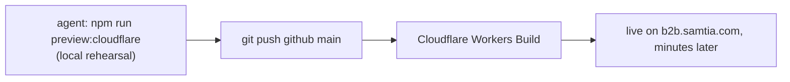

# 018.1 — AI-Agent-Assisted Deployment (Claude Code Skills)

**Purpose:** [018](018-Release-and-Build-Process.md) is the manual command runbook. This page is
the fast path — the same three jobs (release history, staging deploy, production deploy), done by
telling the Claude Code agent what you want instead of typing every command yourself. Read this
first; drop to 018 (full explanation) or [018.2](018.2-Manual-Deployment-Runbook.md) (pure
copy-paste commands, no agent) when something needs to be done by hand or a skill looks out of
date.

**Audience:** new team member taking over DevOps/release duty at handover — written to be skimmed
in minutes, not studied.

**Where to run the agent:** open Claude Code at the **`odoo19`** project root, not inside
`addons_lp_ecommerce` alone. Two of the three skills below live at the `odoo19` root
(`.claude/skills/`); one lives inside `next_ecommerce/` and only triggers while you're working on
files under that folder.

---

## The three skills

| Skill | Lives at | Ask the agent to… |
| --- | --- | --- |
| `staging-deploy` | `next_ecommerce/.claude/skills/staging-deploy/` | bump the portal version, write the release note, build, and push the Docker image |
| `odoo-backend-deploy` | `.claude/skills/odoo-backend-deploy/` | bump `BUILD_NUMBER`, write the release note, open the Azure PR, sync GitHub, verify a live build |
| `docs-sync` | `.claude/skills/docs-sync/` | mirror `_docs/` into the published mkdocs sites (unrelated to app deploy — listed for completeness) |

The agent picks the right skill from plain language — you don't need to name it. Example prompts
that trigger each one are in the tables below.

---

## 1 — Release history

**Rule, not a request:** both deploy skills write a release-note file on **every** version bump,
whether or not you ask for one. You never create `_docs/releases/*.json` or `*.md` by hand.

| | Frontend | Backend |
| --- | --- | --- |
| File | `next_ecommerce/_docs/releases/<version>.json` | `addons_lp_ecommerce/_docs/releases/<module_version>_build<N>.md` |
| Semver decision | Agent reads the diff — patch for bug-only, minor if a user can see something new | N/A — `BUILD_NUMBER` always increments; manifest `version` only bumps if not already raised by another PR |
| Audience split | `changes` = technical/internal. `highlights` = plain language, tagged `client` / `amp` / `general` / `backoffice`, the **only** field the public `/release-notes` page shows | `## Changes` written in plain business language with the PR number, same tone rule |
| Cross-repo link | `headCommitBackend` folds backend commits into the frontend's release note so one file tells the whole story | — |

Say: *"bump the staging version and write the release note"* — the note is produced as part of
the same request, not a separate step.

---

## 2 — Deploy to staging

| | Frontend (`next_ecommerce`) | Backend (`addons_lp_ecommerce`) |
| --- | --- | --- |
| Say | *"build and deploy staging-b2b"* / *"push the docker image to pre-prod"* / *"bump version and push training-b2b"* | *"push the odoo change to staging"* / *"deploy backend to odoo.sh"* |
| Agent does | syncs `main`, bumps `NEXT_PUBLIC_APP_VERSION` in both the env's `.env.<env>` and `docker-compose.yml`, writes the release note, runs `build_upload_amd64.sh --deploy` (or `build_deploy_all_staging.sh` for all three at once), syncs the GitHub mirror | syncs `main`, bumps `BUILD_NUMBER`, writes the release note, opens the Azure DevOps PR, syncs the GitHub mirror after merge |
| **You still do** | **Portainer**: Stacks → stack → Editor → *Re-pull image and redeploy*. The script never restarts the container — UI-only step | **Merge the Azure PR** (approval gate by design). The submodule pointer onto `staging-b2b` can then be bumped directly (the B2B Team has had push access to the Odoo.sh-connected repo since 2026-09 — the agent can do this itself, see below); no need to wait on the ERP Team for this one branch |
| Verify | Portainer shows the new tag; `/release-notes` shows the entry | `curl -s https://staging-b2b-odoo.adv-photonx.com/ecommerce/api/build-info` — `build_number` matches what you just set |

`training` is deployed on its own (not in the combined staging script) — say so explicitly if
that's the target.

**Triggering the Odoo.sh rebuild on `staging-b2b`:** once the backend PR is merged, say *"bump
the odoo.sh submodule"* or *"trigger the staging-b2b rebuild"*. The agent updates the submodule
pointer in the `samtia` repo and pushes it directly — scoped to `staging-b2b` only, it will still
confirm with you first (see "What the agent will always stop and ask about" below), and it will
never do this for `pre-prod`, `training`, or `production`, which stay exclusively the ERP Team's
promotion.

---

## 3 — Deploy to production

Production is **two very different speeds** — say explicitly which one you mean.

### Frontend — fast, automatic, no gate



Say: *"ship this to production"* / *"push main to GitHub for the portal release"*.

The agent will bump `NEXT_PUBLIC_APP_VERSION` in `.env.production`, write the release note,
rehearse with `npm run preview:cloudflare`, and push the GitHub remote's `main` — **and will
confirm with you before that push**, because it deploys instantly with no review gate. Before
confirming, check both:
- Already validated on `staging-b2b` and `pre-prod`.
- Any backend dependency has already reached Odoo.sh `production` — see
  [014 — ordering risk](014-Deployment-Architecture.md#the-ordering-risk-introduced-by-cicd).

### Backend — slow, human-gated, not agent-driven

The agent's own reach ends at `staging-b2b` — it can merge the submodule pointer onto that one
branch (see "Triggering the Odoo.sh rebuild" above), but from `staging-b2b` onward,
`pre-prod → training → production` is promoted **exclusively by the ERP Team** — no API, no CLI,
no agent access to any Odoo.sh branch beyond `staging-b2b`. For that part the agent can only:
- tell you what shipped (the release note it already wrote), and
- verify a promotion happened once the ERP Team confirms it, via the same `build-info` curl above
  pointed at the branch in question.

Don't ask the agent to "deploy the backend to production" (or to pre-prod/training) expecting it
to run anything — ask it to *verify* instead, after the ERP Team says it's done.

---

## What the agent will always stop and ask about

Confirmed with you first, never run silently — because each one is either hard to reverse or
visible to others the moment it happens:

- `git push github main` on `next_ecommerce` or a `main` push on `lp_projects_docs` — both deploy
  live immediately, no review gate.
- Merging/opening the Azure DevOps PR (it can prepare the branch and give you the link; merging is
  yours).
- Pushing the submodule pointer onto `staging-b2b` (direct `samtia` access) — triggers a live
  Odoo.sh rebuild, so it's confirmed first even though it's within the agent's reach.
- Anything on Odoo.sh labeled **Rebuild** — can silently reset a build's database (see
  `odoo-backend-deploy` skill notes); the agent will suggest a backup first.

## What the agent cannot do at all

- Click **Re-pull image and redeploy** in Portainer — UI-only.
- Merge an Azure DevOps PR — a human approval gate owned by people, not automation, by design.
- Promote any Odoo.sh branch beyond `staging-b2b` (i.e. `pre-prod`, `training`, `production`) —
  exclusively the ERP Team's merge authority; no exception, no access granted to this side.

---

## Fast reference — what to say

```text
"bump version and push staging-b2b"                 → frontend staging deploy + release note
"build and deploy pre-prod and training-b2b"         → frontend staging deploy, multiple envs
"push the odoo change" / "deploy backend to staging" → backend staging PR + release note
"bump the odoo.sh submodule" / "trigger staging-b2b"  → direct push to samtia, staging-b2b only (asks to confirm)
"is the fix live on staging"                         → build-info verification, no deploy
"ship this to production"                            → frontend prod deploy (asks to confirm)
"ssh into odoo.sh" / "database error on pre-prod"    → backend diagnostics, no deploy
"sync the docs" / "publish docs"                     → mkdocs site mirror (not app deploy)
```

If a prompt above doesn't trigger the expected skill, the skill file may have moved or been
renamed since this page was written — check the paths in the table under
[The three skills](#the-three-skills) directly rather than assuming this page is wrong.

---

## Related Documents

- [014 — Deployment Architecture](014-Deployment-Architecture.md) — pipeline topology this page
  automates.
- [017 — Odoo.sh Environments Guide](017-Odoo.sh-Environments-Guide.md) — the branch-promotion
  policy the ERP Team follows after the agent's part ends.
- [018 — Release and Build Process](018-Release-and-Build-Process.md) — the full manual runbook;
  use it when a skill is missing, broken, or you need to understand exactly what a command does.
- [018.2 — Manual Deployment Runbook](018.2-Manual-Deployment-Runbook.md) — the exact submodule
  commands behind "bump the odoo.sh submodule" above, § 3.6.
