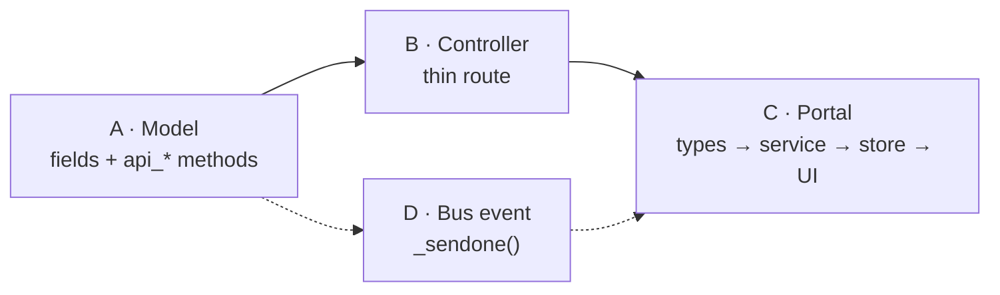
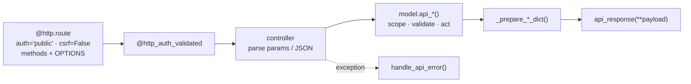
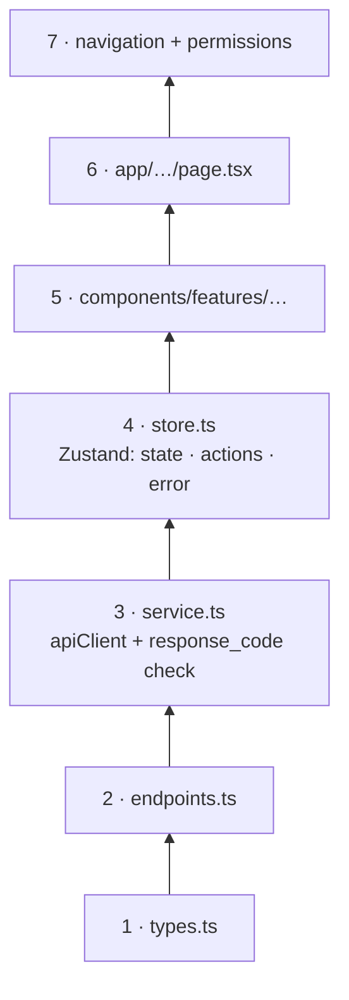
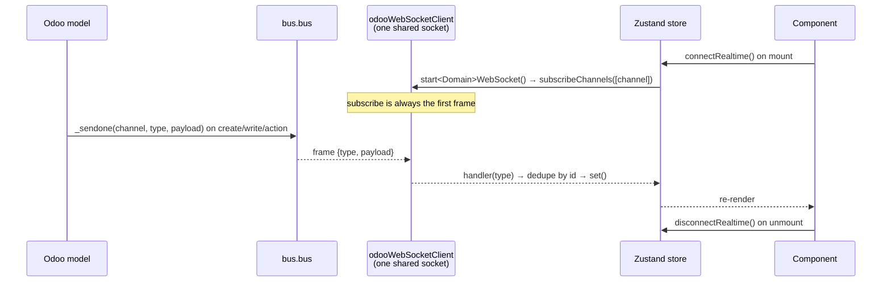

# 019 — Developer Quick Start: Adding a Feature

**Audience:** developer joining the team who must ship a feature this week.
**Goal:** know *which files to touch, in which order, following which pattern* — for any feature
type across both repos.

> Read [006](006-API-and-Controller-Architecture.md), [010](010-NextJS-Application-Architecture.md)
> and [012](012-Realtime-and-Messaging.md) for the *why*. This page is the *how*.

---

## 1 · Pick Your Recipe

| I need to…                                             | Recipe                          | Repos touched   |
| ------------------------------------------------------ | ------------------------------- | --------------- |
| Store new data, add a field, or change business rules  | [A — Odoo model / logic](#a-odoo-model-business-logic) | Odoo            |
| Expose data or an action to a portal                   | [B — REST API endpoint](#b-rest-api-endpoint)          | Odoo            |
| Build a screen in the Customer Portal or AMP           | [C — Next.js feature](#c-nextjs-feature)               | Next.js (+ Odoo for permissions) |
| Push live updates to open browsers                     | [D — Real-time feature](#d-real-time-feature)          | Both            |

A full-stack feature is usually **A → B → C**, plus **D** if it must update live.



---

## 2 · Code Map

### Odoo — `addons_lp_ecommerce/`

| Path                                        | Put here                                                        |
| ------------------------------------------- | --------------------------------------------------------------- |
| `ecommerce/models/<name>.py`                | New model, or `_inherit` extension of an Odoo model             |
| `ecommerce/models/__init__.py`              | Import of every model file                                      |
| `ecommerce/controllers/<name>_api.py`       | Customer Portal routes — `/ecommerce/api/*`                     |
| `ecommerce/controllers_admin/<name>_api.py` | AMP routes — `/ecommerce/api/admin/*`                           |
| `ecommerce/controllers*/__init__.py`        | Import of every controller file                                 |
| `ecommerce/controllers/base_controller.py`  | Shared `sudo()` model accessors (`brand_model`, …)              |
| `ecommerce/api_errors.py`                   | Error-code class + messages in `API_ERROR_MESSAGES`             |
| `ecommerce/api_access.py`                   | Company-scoped record resolution helpers                        |
| `ecommerce/security/ir.model.access.csv`    | Model ACLs                                                      |
| `ecommerce/views/<name>_views.xml`          | ERP Back Office list / form / search / action                   |
| `ecommerce/views/ecommerce_menus.xml`       | ERP Back Office menu entries                                    |
| `ecommerce/data/*.xml`                      | Crons, sequences, mail templates                                |
| `ecommerce/__manifest__.py`                 | Register every new XML/CSV file in `data`                       |
| `ecommerce/migrations/<version>/`           | Pre/post-migration scripts for data changes                     |
| `ecommerce_access_data/data/*.xml`          | AMM screens, permission codes, role assignments                 |
| `lp_base/controllers/base_controller.py`    | Envelope, CORS, `@http_auth_validated` — **do not edit per feature** |

### Next.js — `next_ecommerce/src/`

| Path                                                | Put here                                               |
| --------------------------------------------------- | ------------------------------------------------------ |
| `infrastructure/api/<domain>/<domain>.types.ts`     | Request / response interfaces                          |
| `infrastructure/api/<domain>/<domain>.endpoints.ts` | URL constants and URL builders                         |
| `infrastructure/api/<domain>/<domain>.service.ts`   | Typed calls through `apiClient`                        |
| `infrastructure/api/<domain>/<domain>.websocket.ts` | `start<Domain>WebSocket()` wrapper (real-time only)    |
| `stores/<domain>.store.ts` · `stores/admin/…`       | Zustand store: state, actions, errors                  |
| `components/features/<area>/<domain>/`              | Feature components (AMP → `features/admin/<domain>/`)  |
| `app/<route>/page.tsx`                              | Customer Portal page (wrap in `AuthGuard`)             |
| `app/admin/<route>/page.tsx`                        | AMP page (guarded by the admin layout)                 |
| `components/features/admin/layout/admin-navigation.ts` | AMP sidebar entry                                   |
| `shared/access/access-codes.ts`                     | `AMP_CODES` / `CLIENT_CODES` permission codes          |
| `shared/config/app.config.ts`                       | Any new `NEXT_PUBLIC_*` variable                       |

### Reference implementations — copy these

| Pattern                         | Backend                                                | Frontend                                                |
| ------------------------------- | ------------------------------------------------------ | ------------------------------------------------------- |
| Admin CRUD (list/detail/create/update/delete) | `models/brand.py` · `controllers_admin/brand_api.py` | `infrastructure/api/brand/*` · `stores/brand.store.ts` · `features/admin/brands/` · `app/admin/(product-management)/brands/` |
| Global live feed                | `models/notification.py` (`create` → bus)              | `api/notifications/notifications.websocket.ts` · `notifications.store.ts` |
| Per-record live thread          | `models/mail_message.py` (`_broadcast_chatter_event`)  | `api/chatter/chatter.websocket.ts` · `chatter.store.ts` |
| Company-scoped resolution       | `api_access.py` (`resolve_id_for_user`)                | —                                                       |

---

## A · Odoo Model / Business Logic {#a-odoo-model-business-logic}

### Steps

| # | Do                                                                                         | File                                   |
| - | ------------------------------------------------------------------------------------------ | -------------------------------------- |
| 1 | Create the model (`_name = 'ecommerce.<name>'`) **or** extend one (`_inherit = 'sale.order'`) | `models/<name>.py`                     |
| 2 | Import it                                                                                  | `models/__init__.py`                   |
| 3 | Add ACL rows: `base.group_system`, `ecommerce_group_account_manager`, `ecommerce_group_read_only` (+ `base.group_portal` if portal users read it as themselves) | `security/ir.model.access.csv` |
| 4 | Add list / form / search views and an action                                               | `views/<name>_views.xml`               |
| 5 | Add the menu item                                                                          | `views/ecommerce_menus.xml`            |
| 6 | Register XML files in load order (security → data → views → menus)                         | `__manifest__.py`                      |
| 7 | Upgrade the module: `-u ecommerce`                                                         | —                                      |

### Model layout pattern

Group code into regions — the whole codebase follows this:

| Region                     | Contains                                                      |
| -------------------------- | ------------------------------------------------------------- |
| Fields                     | Field definitions; `tracking=True` on business fields         |
| Compute / onchange         | `@api.depends` methods                                        |
| ORM overrides              | `create` (`@api.model_create_multi`), `write`, `unlink` — always call `super()` |
| API methods                | `api_list_*`, `api_get_*`, `api_create_*`, `api_update_*`, `api_delete_*` |
| Serialisers                | `_prepare_<name>_dict(record)` — one shape reused by list/detail/update |
| Crons                      | `_cron_*` methods, triggered from `data/*_cron.xml`           |

### Which base to inherit

| Need                                                  | Add to `_inherit`                     |
| ----------------------------------------------------- | ------------------------------------- |
| Chatter + field tracking in ERP Back Office           | `mail.thread`, `mail.activity.mixin`  |
| IDs sent to portals must be obfuscated                | `ecommerce.base.secure_model`         |
| ERP Back Office lists refresh live on change          | `ecommerce.base_auto_refresh_model`   |

### Where business logic goes

| Logic type                                   | Place                                                        |
| -------------------------------------------- | ------------------------------------------------------------ |
| Rule that must run however the record is saved | `create` / `write` override                                |
| Rule triggered by a portal action            | The `api_*` method                                           |
| Rule triggered by a Back Office button       | `action_*` method + button in the form view                  |
| Time-based rule                              | `_cron_*` method + `ir.cron` record in `data/`               |
| Order state change                           | `api_update_order` path in `sale_order.py` — never write `portal_state` directly for `quotation_submitted` / `in_progress` (see [016 AD-2](016-Architecture-Decisions-and-Customization-Points.md)) |

> Removed models `ecommerce.tier` and `ecommerce.product.merchant` must not be reused.
> Client segmentation uses `res.partner.grade`.

---

## B · REST API Endpoint {#b-rest-api-endpoint}

### Request flow



### Steps

| # | Do                                                                                      | File                                |
| - | --------------------------------------------------------------------------------------- | ----------------------------------- |
| 1 | Add an error-code class `<Name>ApiErrors(ApiErrorCodes)` in the next free code block     | `api_errors.py`                     |
| 2 | Add every new code's English message                                                    | `api_errors.py` → `API_ERROR_MESSAGES` |
| 3 | Write `api_*` method(s) returning a dict with `response_code` + payload                  | `models/<name>.py`                  |
| 4 | Create the controller class subclassing `BaseController`                                | `controllers/` or `controllers_admin/` |
| 5 | Import the controller file                                                              | `controllers*/__init__.py`          |
| 6 | Test with Postman / curl using a logged-in session cookie                               | —                                   |

### Controller skeleton

```python
from odoo import http
from odoo.http import request
from ..controllers.base_controller import BaseController, http_auth_validated


class WidgetApiController(BaseController):

    @http.route('/ecommerce/api/admin/widgets', type='http', auth='public',
                methods=['GET', 'OPTIONS'], csrf=False)
    @http_auth_validated
    def list_widgets_admin(self, **kwargs):
        try:
            payload = request.env['ecommerce.widget'].sudo().api_list_widgets(dict(request.params))
            return self.api_response(**payload)
        except Exception as ex:
            return self.handle_api_error(ex)
```

### Model method skeleton

```python
@api.model
def api_get_widget(self, widget_id):
    widget, error = resolve_id_for_user(self, widget_id, WidgetApiErrors.WIDGET_NOT_FOUND)
    if error:
        return {'response_code': error}
    return {
        'response_code': WidgetApiErrors.SUCCESS,
        'data': {'widget': self._prepare_widget_dict(widget.sudo())},
    }
```

### Rules

| Rule                                   | Detail                                                                     |
| -------------------------------------- | -------------------------------------------------------------------------- |
| Route prefix                           | Customer Portal `/ecommerce/api/<resource>` · AMP `/ecommerce/api/admin/<resource>` (not the legacy `/api/admin/*`) |
| URL verbs                              | `GET` list/detail · `POST` for `…/create`, `…/update`, `…/delete`          |
| **Unique method name**                 | Across *all* controllers — suffix AMP methods with `_admin`. A duplicate name silently drops a route (looks like a CORS error, is a 404) |
| Thin controller                        | Parse → one model call → `api_response`. No business logic                 |
| Current user                           | `request.env.user` — never trust a `user_id` from the request for authorisation |
| **Tenant scope (mandatory)**           | Portal reads filter by `user.portal_company_partner_id`; AMP reads filter by companies where `account_manager_user_id = user`. Use `api_access.py` helpers for ID lookups |
| Business errors                        | HTTP 200 + non-zero `response_code`. Only session expiry returns 401       |
| Pagination                             | `page` (default 1) + `limit` (default 20) → return `pagination {page, limit, total, pages}` |
| Messages                               | English only; no new localised message keys                                |

---

## C · Next.js Feature {#c-nextjs-feature}

### Layers — build bottom-up



**Layer rule:** components never call `apiClient`; services never import React. Only stores
connect both.

### Steps

| # | Do                                                                                          | File                                                  |
| - | ------------------------------------------------------------------------------------------- | ----------------------------------------------------- |
| 1 | Define request / response interfaces mirroring the API payload                             | `infrastructure/api/<domain>/<domain>.types.ts`       |
| 2 | Add URL constants (`list`, `details`, `create`, `update(id)`, `delete(id)`)                  | `…/<domain>.endpoints.ts`                             |
| 3 | Write the service: call `apiClient.get(url, { params })` / `apiClient.post(url, { body })`; if `response_code !== '0'` throw `Error(response_message)`; log with `logger` | `…/<domain>.service.ts` |
| 4 | Create the store with `DEFAULT_STATE`, `isLoading`, `error`, `filters`, `pagination`, and one action per service call; wrap with `subscribeWithSelector(devtools(…))` | `stores/<domain>.store.ts` (AMP: `stores/admin/`) |
| 5 | Build table / form / modal components reading the store                                     | `components/features/<area>/<domain>/`                |
| 6 | Add the page                                                                                | see portal table below                                |
| 7 | Add the navigation entry and permission codes                                               | see portal table below                                |

### Customer Portal vs AMP

| Concern          | Customer Portal                                     | AMP (Account Management Portal)                         |
| ---------------- | --------------------------------------------------- | ------------------------------------------------------- |
| Page location    | `app/<route>/page.tsx`                              | `app/admin/<route>/page.tsx` (route groups like `(product-management)` add no URL segment) |
| Guard            | Wrap content in `<AuthGuard>`                       | Automatic via `app/admin/layout.tsx` (`AdminGuard`)     |
| Screen gate      | —                                                   | `useScreenGuard(CODES.<x>.screen)`; render `null` while loading or denied |
| Navigation       | Header / company-profile `Navbar.tsx` (profile tabs use `?page=`) | `components/features/admin/layout/admin-navigation.ts` with `screen: CODES.<x>.screen` |
| Permission codes | `CLIENT_CODES` — `client.<screen>.<action>`         | `AMP_CODES` (alias `CODES`) — `amp.<screen>.<action>`   |
| Button gating    | `<Can code={CLIENT_CODES.<x>.create}>`              | `<Can code={CODES.<x>.create}>`                         |
| Backend route    | `/ecommerce/api/*`                                  | `/ecommerce/api/admin/*`                                |

### Registering a new screen with AMM

The screen catalogue lives in two places joined by the screen **`reference`**:

| # | Record                                   | File                                                        |
| - | ---------------------------------------- | ----------------------------------------------------------- |
| 1 | Frontend codes `{ screen, view, create, edit, delete }` | `shared/access/access-codes.ts`              |
| 2 | `access.screen` with the same `reference` and `path`     | `ecommerce_access_data/data/access_screen_catalogue_data.xml` |
| 3 | One `access.permission` per action code  | `ecommerce_access_data/data/access_permission_data.xml`     |
| 4 | Add the permission refs to each role that should have them | `ecommerce_access_data/data/access_role_data.xml`         |

> When AMM is not installed the permission store runs in OPEN mode and everything renders — so
> a missing record will only show up on an environment *with* AMM. Test there.

### Frontend rules

| Rule                          | Detail                                                          |
| ----------------------------- | --------------------------------------------------------------- |
| No raw URLs in components     | Endpoint strings live only in `*.endpoints.ts`                  |
| No `process.env` reads        | Use `config` from `shared/config/app.config.ts`                 |
| Branch on `response_code`     | Never on HTTP status — business errors are HTTP 200             |
| One store per domain          | No store imports another store; compose in components          |
| Theme with CSS variables      | `var(--bg-card)`, `var(--text-primary)`… — never hard-coded colours |
| Session expiry                | Already handled by the `apiClient` interceptor (`'401'` → `/login`) |
| UI-facing change              | Add a `highlights` entry to the release file (`_docs/releases/<version>.json`) |

---

## D · Real-Time Feature {#d-real-time-feature}

### Flow



### Backend steps

| # | Do                                                                                   | File                         |
| - | ------------------------------------------------------------------------------------ | ---------------------------- |
| 1 | Choose a **literal string** channel and a `<area>/<event>` message type              | —                            |
| 2 | Call `self.env['bus.bus']._sendone(channel, type, payload)` after the change         | `models/<name>.py` (in `create` / `write` / `api_*`) |
| 3 | Keep the payload small and JSON-safe: ids, labels, scope keys (`portal_company_partner_id`, …) | same                         |

### Frontend steps

| # | Do                                                                                                   | File                                          |
| - | ---------------------------------------------------------------------------------------------------- | --------------------------------------------- |
| 1 | Write `start<Domain>WebSocket(options)`: `subscribeChannels([channel])` + `subscribeToType(type, h)` + optional `onConnectionChange`; return one function that calls every unsubscribe | `infrastructure/api/<domain>/<domain>.websocket.ts` |
| 2 | Normalise the raw payload into a typed object inside that file                                        | same                                          |
| 3 | Add `connectRealtime` / `disconnectRealtime` store actions; keep a session counter so late callbacks after disconnect are ignored | `stores/<domain>.store.ts`                    |
| 4 | Merge events idempotently — skip if the id is already in state                                       | same                                          |
| 5 | Filter events that are not for the current user (company, owner, account manager)                    | same                                          |
| 6 | Call `connectRealtime` in a component `useEffect`, `disconnectRealtime` in its cleanup                | `components/features/…`                       |

### Existing channels

| Channel                       | Message type(s)                                   | Emitted by                          |
| ----------------------------- | ------------------------------------------------- | ----------------------------------- |
| `ecommerce/notification`      | `ecommerce/notification`                          | `ecommerce.notification.create`     |
| `ecommerce/presence`          | `ecommerce/presence`                              | `res.users` presence change         |
| `discuss.channel_<uuid>`      | `discuss.channel/new_message`                     | `discuss.channel.message_post` mirror |
| `chatter_<res_model>_<res_id>`| `chatter/new_message` · `update_message` · `attachment_upload` · `attachment_delete` | `mail.message._broadcast_chatter_event` |
| `auto_refresh`                | `auto_refresh`                                    | `ecommerce.base_auto_refresh_model` (Back Office only) |

### Real-time rules

| Rule                                          | Why                                                                          |
| --------------------------------------------- | ---------------------------------------------------------------------------- |
| Use **string** channels, never record channels | The Odoo.sh gateway relays only literal string channels to the portals      |
| Never open a second socket                    | Always go through `odooWebSocketClient`; channels are ref-counted            |
| Never send a frame before `subscribe`         | Odoo.sh closes with 4001 → endless reconnect                                 |
| **Treat every payload as public to logged-in users** | Odoo does not authorise client-chosen string channels — any session can subscribe to any name. Send ids and scope keys; let the client refetch details through a scoped REST endpoint |
| Deduplicate by id                             | On-premises delivers some messages twice (record channel + mirror)           |
| Test on Odoo.sh staging                        | Gateway behaviour cannot be reproduced locally ([016 AD-9](016-Architecture-Decisions-and-Customization-Points.md)) |

---

## 3 · Full-Stack Checklist

Use as the PR description checklist.

| Area        | Check                                                                                    |
| ----------- | ---------------------------------------------------------------------------------------- |
| Model       | Imported in `__init__.py` · ACL rows added · XML files in manifest · module upgrades cleanly |
| Security    | Every read scoped by company / account manager · IDs resolved through `api_access.py`   |
| API         | Unique method names · `OPTIONS` in methods · error codes + messages in `api_errors.py`  |
| API         | Postman collection updated                                                               |
| Portal      | types → endpoints → service → store → components → page, in that order                  |
| Portal      | Nav entry + `access-codes.ts` + AMM screen/permission/role records in sync               |
| Real-time   | String channel · payload holds no sensitive data · dedupe + scope filter on the client   |
| Release     | Backend deployed before the portal ([016 AD-13/14](016-Architecture-Decisions-and-Customization-Points.md)) · release `highlights` written for UI changes |
| Docs        | New endpoint in [006](006-API-and-Controller-Architecture.md) · new model in [005](005-Domain-Model.md) · new feature in [009](009-Feature-Catalog.md) |

---

## 4 · Common Pitfalls

| Symptom                                           | Cause                                                             | Fix                                                         |
| ------------------------------------------------- | ----------------------------------------------------------------- | ----------------------------------------------------------- |
| CORS error in the browser on a new route          | Route not registered — duplicate method name or missing import    | Rename method; add the file to `controllers*/__init__.py`   |
| HTML login page returned instead of JSON          | Route uses `auth='user'`                                          | Use `auth='public'` + `@http_auth_validated`                |
| Preflight fails                                   | `OPTIONS` missing from `methods`                                  | Add `'OPTIONS'`                                             |
| Customer sees another company's data              | Missing company scope in the domain                               | Filter by `portal_company_partner_id`; use `api_access.py`  |
| `AccessError` for portal users only               | No ACL row for `base.group_portal` when resolving as the user     | Add the ACL row, or serialise under `sudo()` after resolution |
| Menu / screen hidden on staging but fine locally  | AMM installed there; screen or permission record missing           | Add records in `ecommerce_access_data`                      |
| New field missing after deploy                    | Module not upgraded on the target database                        | Upgrade `ecommerce` — see [017](017-Odoo.sh-Environments-Guide.md) |
| Live update works locally, not on Odoo.sh         | Record channel used, or a frame sent before `subscribe`           | Switch to a string channel; use `odooWebSocketClient` only  |
| Duplicate items appear live                       | Event merged without id check                                     | Dedupe by id in the store                                   |
